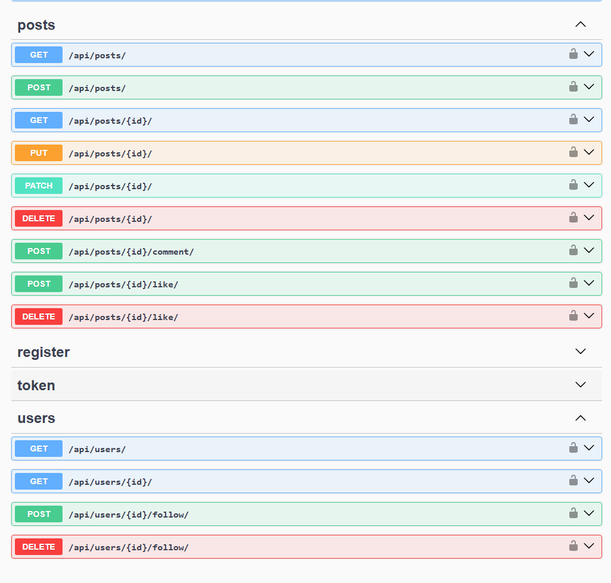

# Welcome to Social Media API!

## Overview
This project is an API for a sample Social Media:
- can register, login and logout users.
- can follow and unfollow users.
- can create, update, delete and schedule publication of posts.
- can comment to said posts.
- can like and unlike posts.

---

## Key Features

- Complex Models
- JWT Authentication
- User login via email
- Creation of new instances and search of existing ones with filtering
- Admin panel
- Documentation with Swagger
- Possibility to add profile picture
- Scheduling of post creation

---

## Tech Stack
- **Framework:** Django REST Framework (Python)
- **Database:** SQLite
- **Authentication:** JSON Web Token
- **Scheduling:** Celery, Celery-Beat

---

## Installation
```bash
git clone <url of the repo>
python -m venv venv
source venv/bin/activate
```

**There is an example of .env file that is necessary.**

```bash
pip install -r requirements.txt
python manage.py migrate
python manage.py runserver
```


## Demo
